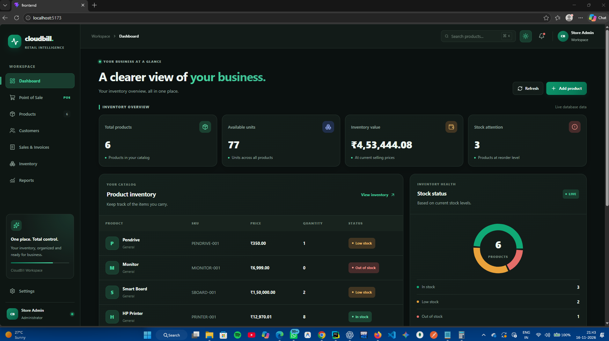
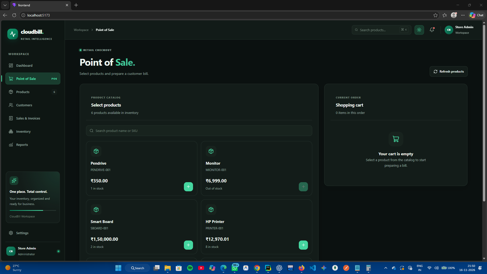
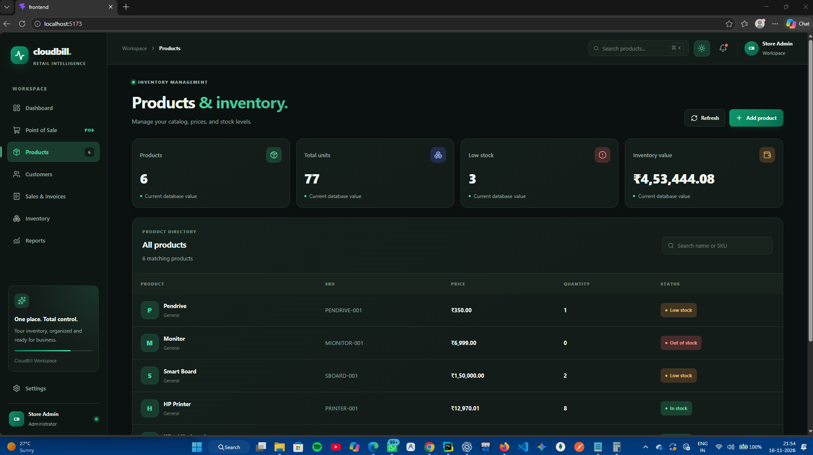
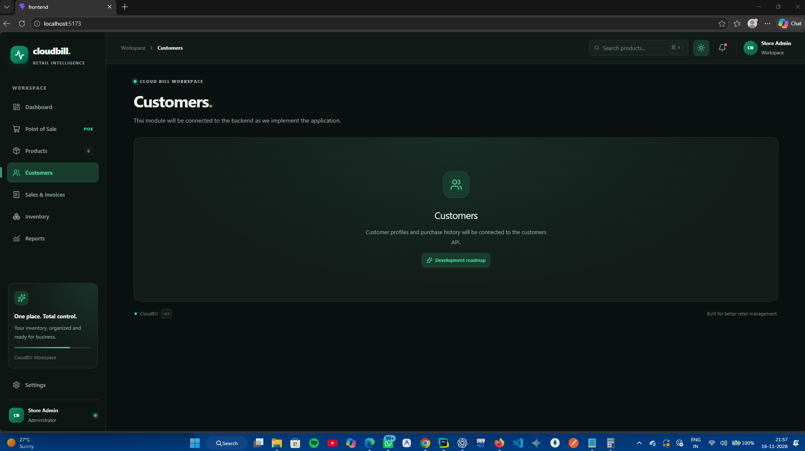
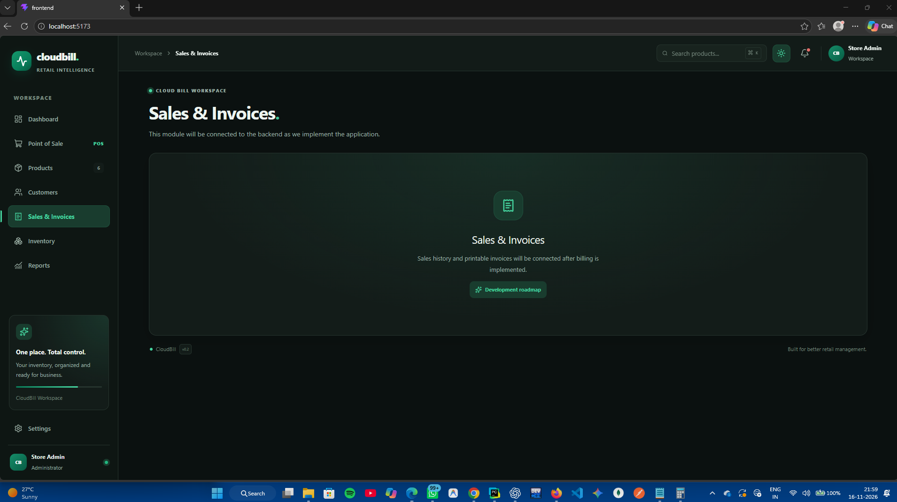
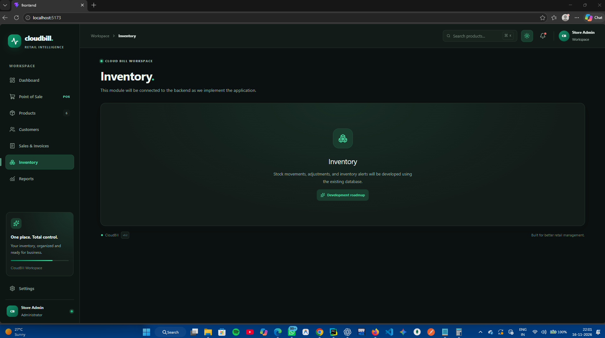

# CloudBill – Cloud-Based Retail Billing System

A full-stack retail billing and inventory management application built using **React, Flask, and MySQL**.

CloudBill is designed to simplify retail billing operations, product management, sales processing, and inventory tracking through a web-based interface.

---

## Overview

CloudBill provides a centralized platform for managing retail operations. It combines a React-based frontend, a Python Flask backend, and a MySQL relational database.

The application includes product management, sales processing, billing-related database operations, and inventory tracking capabilities.

## Technology Stack

| Layer | Technologies |
|---|---|
| Frontend | React.js, JavaScript, HTML5, CSS3 |
| Frontend tooling | Vite, npm |
| Backend | Python, Flask |
| Database | MySQL |
| Database connectivity | PyMySQL |
| API integration | REST APIs |
| Environment configuration | python-dotenv |
| Version control | Git and GitHub |

## Features

- **Product Management:** Backend API for retrieving product information.
- **Sales Processing:** Backend checkout functionality for processing sales.
- **Billing Database:** Structured storage for sales, invoices, sale items, and payments.
- **Inventory Management:** Product stock quantities, stock movement history, and reorder levels.
- **Customer Records:** Database structure for maintaining customer information.
- **User Management:** Database support for administrator and cashier accounts.
- **Notifications:** Database support for low-stock and out-of-stock notifications.
- **React Interface:** Web-based frontend for interacting with the application.

## Project Architecture

```text
CloudBill/
│
├── backend/
│   ├── app/
│   │   ├── routes/
│   │   │   ├── __init__.py
│   │   │   ├── products.py
│   │   │   └── sales.py
│   │   │
│   │   ├── __init__.py
│   │   ├── config.py
│   │   └── db.py
│   │
│   ├── database/
│   │   └── schema.sql
│   │
│   ├── .env.example
│   ├── requirements.txt
│   └── run.py
│
├── frontend/
│   ├── public/
│   ├── src/
│   │   ├── assets/
│   │   ├── App.jsx
│   │   ├── App.css
│   │   ├── index.css
│   │   └── main.jsx
│   │
│   ├── package.json
│   ├── package-lock.json
│   └── vite.config.js
│
└── .gitignore
```

## Database Design

CloudBill uses MySQL with the following main tables:

| Table | Description |
|---|---|
| users | Administrator and cashier accounts |
| categories | Product categories |
| products | Product information and inventory |
| customers | Customer records |
| sales | Sales transactions and invoices |
| sale_items | Individual items in each sale |
| payments | Payment transaction records |
| stock_movements | Inventory movement history |
| notifications | Stock-related notifications |

The database schema is available at:

`backend/database/schema.sql`

## Installation and Setup

### Prerequisites

Make sure you have installed:

- Python 3.10 or later
- Node.js and npm
- MySQL Server
- Git

### 1. Clone the repository

```bash
git clone https://github.com/Ravikantjha750/CloudBill.git
cd CloudBill
```

### 2. Configure the MySQL database

Start your MySQL server and execute:

```bash
mysql -u root -p < backend/database/schema.sql
```

### 3. Set up the backend

Open a terminal:

```bash
cd backend
```

Create a virtual environment:

```bash
python -m venv .venv
```

Activate it on Windows:

```powershell
.venv\Scripts\Activate.ps1
```

Install dependencies:

```bash
pip install -r requirements.txt
```

### 4. Configure environment variables

Create a `.env` file inside the `backend` directory.

Use `backend/.env.example` as a reference.

Configure the following variables:

```env
SECRET_KEY=your-secret-key

DB_HOST=localhost
DB_PORT=3306
DB_USER=root
DB_PASSWORD=your-mysql-password
DB_NAME=cloud_retail_billing

FLASK_DEBUG=False
```

Replace the placeholder values with your local configuration. Never upload your actual `.env` file to GitHub.

### 5. Start the Flask backend

From the `backend` directory:

```bash
python run.py
```

### 6. Start the React frontend

Open another terminal:

```bash
cd frontend
```

Install frontend dependencies:

```bash
npm install
```

Start the development server:

```bash
npm run dev
```

Open the local URL displayed by Vite in your browser.

## Backend API

The backend exposes API routes for product and sales operations.

| Endpoint | Purpose |
|---|---|
| `/api/products` | Product-related operations |
| `/api/sales/checkout` | Sales checkout processing |

The Flask application also includes a database connectivity check.

## Future Improvements

Potential areas for further development include:

- Enhanced authentication and role-based access control.
- Advanced sales analytics and reporting.
- Improved invoice generation and management.
- Enhanced payment gateway integration.
- Automated inventory alerts.
- Cloud deployment and production configuration.

## Learning Outcomes

This project demonstrates practical implementation of:

- Full-stack web application development.
- REST API development using Flask.
- React frontend integration.
- Relational database design using MySQL.
- Backend-database connectivity.
- Environment variable management.
- Git-based version control and collaboration.

## Author

**Ravikant Jha**

MCA Student | Full Stack Developer

GitHub: [@Ravikantjha750](https://github.com/Ravikantjha750)

---
## Application Screenshots

### Dashboard


### Point of Sale (POS)


### Product Management & Inventory


### Customers Module (Under Development)


### Sales & Invoices (Under Development)


### Inventory Module (Under Development)


If you find this project useful, consider giving the repository a ⭐.